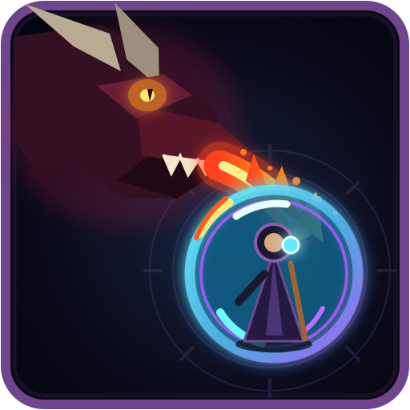

<p align="center">
  
</p>

# Eldritch Aeons

> Study the world. Name its laws. Break them carefully.

**Eldritch Aeons** is a dark-fantasy magic and exploration modpack for **Minecraft 26.1.2** on **NeoForge**. It is built around deliberate magical progression: scan and research the world, bind spirits, inscribe spell syntax, survive dangerous ruins, and eventually force dragonfire into materials never meant to contain it.

This is not a kitchen-sink pack where every powerful system is available immediately. Major mechanics are connected through custom research, recipes, quests, and cross-mod progression.

**Status:** Public beta — v1.1  
**Canonical download:** CurseForge project page will be linked here after publication.  
**Repository purpose:** Pack-specific source, documentation, issue tracking, and release materials. Third-party mod JARs are distributed through the CurseForge manifest, not committed here.

## What makes the pack different

### Arcane Syntax

Build a Spell has been rebuilt around a learned magical language rather than random rune conversion.

- A **Worn Wand** teaches only the fundamental instruction: **Cast**.
- Players craft **Blank Runes**, inscribe exact concepts, and permanently learn them by consuming the finished rune.
- **75 spell components** are distributed across four progression tiers.
- Early syntax is written at the Arcane Workbench; more abstract concepts require Occultism rituals; powerful syntax requires Thaumaturge infusion; forbidden capstones demand eldritch materials and research.
- Spell balance, rune acquisition, tooltips, textures, and research are all pack-specific.

See [Custom Systems](docs/CUSTOM_SYSTEMS.md) and the [Arcane Syntax system notes](source/arcane-syntax/).

### Draconic Artifice

Dragonsteel is no longer ordinary iron exposed to dragon breath.

- Dragonforge masonry uses **Dreadstone** instead of ordinary stone brick.
- Dragonforge Apertures and Cores are constructed through the **Thaumaturge Infusion Matrix**.
- **Thaumium** replaces iron as the Dragonsteel feedstock.
- A dedicated **Breath-Forged Metallurgy** research path requires advanced Arcane Syntax and Thaumaturge progression.

See the [Draconic Artifice system notes](source/draconic-artifice/).

### Thaumaturgy that respects modern storage

The bundled **Tom's Thaumometer** compatibility addon (`thaumic_storage_scanning`) lets a player use a Thaumometer directly inside a Tom's Simple Storage terminal. Known aspects are displayed in the terminal, and new items can be researched without pulling each stack into the player inventory.

### Connected occult progression

Thaumaturge, Build a Spell, Occultism, Ice and Fire, Twilight Forest, Vampirism, FTB Quests, and the pack's exploration content are treated as parts of one setting rather than isolated mod islands. The result is a more coherent route from improvised magic to reality-bending research.

## Major content pillars

- **Research and spellcraft:** Thaumaturge, Build a Spell, KubeThaum, Occultism
- **Dragons and dangerous creatures:** Ice and Fire Community Edition
- **Dimensions and exploration:** Twilight Forest, When Dungeons Arise, Seven Seas, Towns and Towers
- **Dark supernatural play:** Vampirism and related faction systems
- **Character growth and loot:** Apothic Attributes, Enchanting, and Spawners
- **Questing and multiplayer:** FTB Quests, Teams, Chunks, and Essentials
- **Storage and logistics:** Tom's Simple Storage, Storage Drawers, Sophisticated Backpacks
- **Navigation and quality of life:** JEI, Xaero's maps, Waystones, Lootr, Carry On, and curated utility mods

A selected version inventory is maintained in [docs/MOD_LIST.md](docs/MOD_LIST.md). The CurseForge manifest remains authoritative for the complete release.

## Repository layout

```text
assets/                     Project icon and listing artwork
packages/                   Release-package notes
source/arcane-syntax/       Arcane Syntax system documentation
source/draconic-artifice/   Draconic Artifice system documentation
source/pack-overrides/        Release-tracked pack-owned override notes and fixes
docs/                       Installation, compatibility, release, and listing notes
.github/ISSUE_TEMPLATE/      Bug and feature request templates
```

The v1.1 CurseForge manifest and release checksums are retained under `packages/` for reproducibility; normal players should still install from CurseForge. The documentation is kept here for development and auditability. Most players should install Eldritch Aeons through CurseForge.

## Installation

### Players

Install the approved Eldritch Aeons profile from CurseForge. Do not independently mix versions of Thaumaturge, KubeThaum, Build a Spell, Occultism, or Ice and Fire unless you are prepared to debug recipe and data compatibility.

### Dedicated servers

Use the server pack matching the client release. Pack-specific KubeJS item registration and the Thaumic Storage Scanning addon must be present on both client and server. See [Installation and Server Setup](docs/INSTALLATION.md).

## Known compatibility note

Thaumaturge 1.0.2 currently registers the six Arcane Workbench crystal slots as JEI transfer inputs. Clicking JEI's **Move Items** button for an Arcane Workbench recipe can eject stored vis crystals and may make dropped crystals difficult to recover. Until the upstream regression is fixed, place Arcane Workbench ingredients manually or remove stored crystals first. See [Known Issues](docs/KNOWN_ISSUES.md).

## Reporting problems

Use the repository's [Issues](https://github.com/PhaedrusXY/Eldritch_Aeons/issues) page and include:

- exact pack version;
- single-player or dedicated server;
- steps to reproduce;
- relevant `latest.log`, `debug.log`, or crash report;
- whether the problem occurs in a clean profile without additional mods.

## Credits and permissions

Eldritch Aeons is curated by **PhaedrusXY**. The included third-party mods, names, assets, and code remain the property of their respective authors and are not relicensed here. Repository-original pack scripts, writing, documentation, and integration files are released under the [MIT License](LICENSE); third-party rights and distribution boundaries are explained in [LICENSE-NOTICE.md](LICENSE-NOTICE.md).
