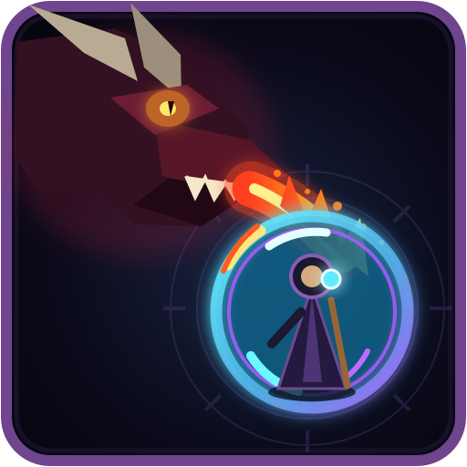

  

# Eldritch Aeons

> Study the world. Name its laws. Break them carefully.

**Eldritch Aeons** is a dark-fantasy magic and exploration modpack for **Minecraft 26.1.2** on **NeoForge**. Scan and research the world, bind spirits, inscribe spell syntax, survive dangerous ruins, and eventually force dragonfire into materials never meant to contain it.

Major mechanics are connected through custom research, recipes, quests, and cross-mod progression rather than offered as isolated mod systems.

**Status:** Public beta, with a separate experimental development track. The archived manifests in this repository cover v1.2–v1.3; they are historical release records, not a declaration of the latest CurseForge version.  
**Repository purpose:** Pack-specific documentation, source notes, issue tracking, and release materials. Third-party mod JARs are not committed here.

## Current development: unified focus casting

**Arcane Syntax 0.2.1** targets **Thaumaturge 1.1.0** and **Build a Spell 1.0.3**. Initial in-game testing is underway; this is not yet a new public pack-release announcement.

The addon source and its reference pack overlay now have a dedicated home: **[Arcane Syntax](https://github.com/PhaedrusXY/Arcane_Syntax)**. The mod ID remains `arcane_syntax_unified`.

### Arcane Syntax

Build a Spell's learned magical language is now cast through Thaumaturge's native equipment and resource system:

- Craft Blank Runes, inscribe specific concepts, and consume the finished runes to learn them permanently.
- Use the **Focal Manipulator** to inscribe learned Syntax onto a Thaumaturge focus, then cast through a native wand or staff using **Vis** instead of the personal BaS mana pool.
- Equipment progression uses three focus tiers: **Foundation / Lesser**, **Structured / Advanced**, and **Infused / Greater**. The old Worn, Carved, and Runic BaS wands are no longer progression dependencies.
- **Conjure, Wall, and Floor are Foundation components.** Fill and Increased Area remain Structured.
- Native Thaumaturge spells remain available, but native and Syntax components cannot be mixed within one spell. Syntax currently uses Instant casting and a linear composition.
- **Break + Fill is blocked**; Break + Increased Area remains available subject to the usual costs and tier checks.
- The **0.1 Vis-per-mana conversion** is retained, with native discounts applied afterward. The obsolete personal-mana HUD and separate BaS player-casting routes are retired by default.

See [Custom Systems](docs/CUSTOM_SYSTEMS.md) and [the current integration/testing notes](docs/UNIFIED_CASTING.md). Older files under `source/arcane-syntax/` document the historical wand-based implementation; do not install them over the current focus migration.

### Research with a deteriorating narrator

Arcane Syntax and Draconic Artifice writing has been polished toward the Thaumonomicon's progression from cautious observation to overconfidence and increasingly questionable judgment. The optional **Two Grammars** entry comments on the two incompatible spell grammars without presenting hybrid spells as an implemented feature.

### Draconic Artifice

Dragonsteel is no longer ordinary iron exposed to dragon breath. Dragonforge masonry uses **Dreadstone**, Apertures and Cores use **Thaumaturge infusion**, and **Thaumium** replaces iron as Dragonsteel feedstock. In the focus migration, the downstream research milestone uses a **Greater Focus**, not a retired Runic Wand.

### Thaumaturgy that respects modern storage

The bundled **Tom's Thaumometer** compatibility addon (`thaumic_storage_scanning`) lets a player use a Thaumometer directly inside a Tom's Simple Storage terminal. This is a separate addon from Unified Casting.

## Major content pillars

- **Research and spellcraft:** Thaumaturge, Build a Spell, KubeThaum, Occultism, and Arcane Syntax
- **Dragons and dangerous creatures:** Ice and Fire Community Edition
- **Dimensions and exploration:** Thaumaturge's Outer Lands, Twilight Forest, When Dungeons Arise, Seven Seas, and Towns and Towers
- **Dark supernatural progression:** Vampirism
- **Character growth and loot:** Apothic Attributes, Enchanting, and Spawners
- **Questing and multiplayer:** FTB Quests, Teams, Chunks, and Essentials
- **Storage and logistics:** Tom's Simple Storage, Storage Drawers, and Sophisticated Backpacks
- **Navigation and quality of life:** FTB Chunks' map in the current test setup, JEI, Waystones, Lootr, Carry On, and curated utility mods

## Installation

Normal players should install the approved Eldritch Aeons profile from CurseForge and use a matching server pack. Do not mix a historical manifest with a current experimental overlay.

For the 0.2.1 development candidate, keep matching addon/scripts on client and server, fully close Minecraft before replacing JARs or startup scripts, and back up the instance and world. No new world is required for initial compatibility testing; a fresh character/world is useful later for progression testing.

See [Known Issues](docs/KNOWN_ISSUES.md) and [Unified Casting migration notes](docs/UNIFIED_CASTING.md), including removal of obsolete Outer Lands template overrides.

## Credits and permissions

Eldritch Aeons is curated by **PhaedrusXY**. Third-party mods, names, assets, and code remain the property of their respective authors. Repository-original pack scripts, writing, documentation, and integration files are released under the [MIT License](LICENSE).
